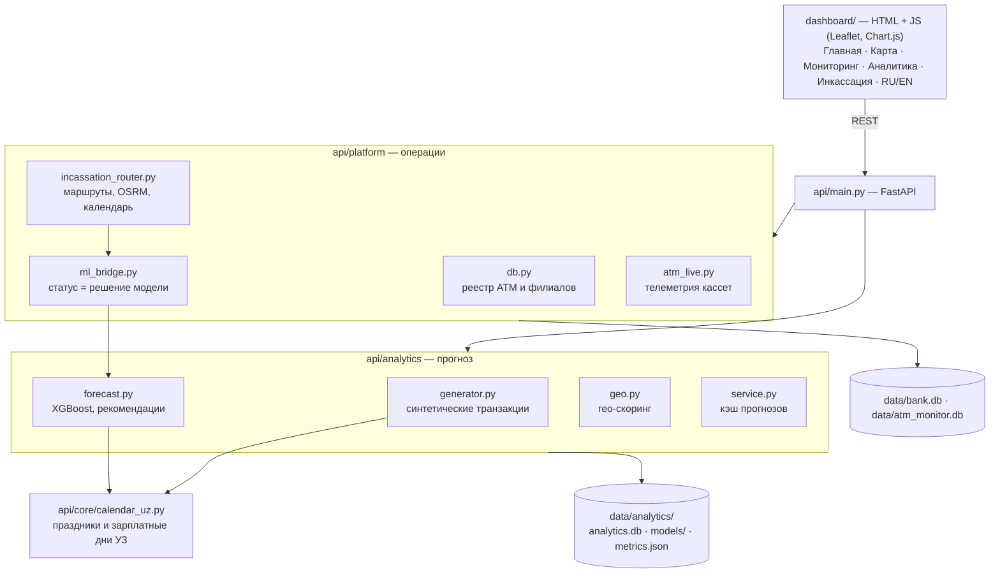

# Cash Flow AI

**Прогноз спроса на наличные и планирование инкассации для сети банкоматов.**
Модель подсказывает, *когда* выехать к банкомату, *сколько* загрузить и *по какому маршруту* ехать, —
чтобы банкоматы не оставались без денег, а банк не замораживал лишние наличные в сети.

Демо-сеть: 144 банкомата Ipak Yo'li Bank в Ташкенте (адреса и координаты — из открытого реестра ЦБ РУз).

---

## Содержание

- [Проблема](#проблема)
- [Решение](#решение)
- [Возможности](#возможности)
- [Как работает прогноз](#как-работает-прогноз)
- [Качество модели](#качество-модели)
- [Маршруты и календарь инкассации](#маршруты-и-календарь-инкассации)
- [Гео-скоринг локаций](#гео-скоринг-локаций)
- [Данные](#данные)
- [Архитектура](#архитектура)
- [Быстрый старт](#быстрый-старт)
- [Деплой на Railway](#деплой-на-railway)
- [API](#api)
- [Тесты](#тесты)
- [Допущения и ограничения](#допущения-и-ограничения)

---

## Проблема

Сегодня банк загружает банкоматы «стандартным комплектом» и ездит по расписанию.
Это приводит к двум противоположным потерям:

| Потеря | Что происходит |
|---|---|
| **Cash-out** | Банкомат с высоким спросом (рынок, метро, зарплатный день) пустеет раньше визита — клиенты уходят, растут жалобы и аварийные выезды. |
| **Замороженные деньги** | Банкомат с низким спросом стоит с почти полной загрузкой — наличные не работают, банк теряет на стоимости денег. |

## Решение

Cash Flow AI связывает три вещи в одну цепочку:

1. **Прогноз спроса** — XGBoost предсказывает почасовые снятия каждого банкомата на 7 дней вперёд с интервалами неопределённости.
2. **Решение по каждому банкомату** — срок визита и сумма загрузки на заданном уровне сервиса (99%), с раскладкой по кассетам 10k / 50k / 100k / 200k.
3. **Логистика** — региональные маршруты от пунктов инкассации, оптимизация обхода, геометрия по дорогам и календарь рейсов по рабочим дням.

---

## Возможности

Интерфейс — 5 страниц с общей навигацией и переключателем языка **RU / EN**.

| Страница | Что внутри |
|---|---|
| **Главная** `/dashboard/index.html` | Обзор платформы и быстрый переход к модулям. |
| **Карта** `/dashboard/map.html` | Сеть банкоматов на карте с цветом статуса (норма / предупреждение / критично), карточка банкомата с кассетами и прогнозом, построение маршрутов инкассации, слой филиалов, гео-скоринг (тепловая карта, оценка любой точки, «белые пятна»), банкоматы конкурентов. |
| **Мониторинг и прогноз** `/dashboard/atm-analytics.html` | Таблица сети с фильтрами и поиском; по каждому банкомату — кассеты, график остатка (факт + прогноз P10–P90), срок визита, рекомендуемая загрузка, объяснение прогноза, транзакции. |
| **Аналитика** `/dashboard/analytics.html` | Денежный поток сети за период (12 ч / 24 ч / 7 д / 30 д), топ банкоматов по спросу и по риску cash-out, история транзакций. |
| **Инкассация** `/dashboard/incassation.html` | Календарь рейсов по дням, горизонт 2 / 7 / 14 дней, рейсы дня по вилоятам, карточка рейса с остановками и переходом на карту, кнопка «Обновить план». |

Swagger со всеми эндпоинтами — `/docs`.

---

## Как работает прогноз

### Модель спроса

- **Алгоритм:** XGBoost (Tweedie-регрессия), одна глобальная модель для всех банкоматов. Цель — спрос на наличные за час, включая неудовлетворённый спрос во время cash-out.
- **Горизонт:** 168 часов (7 суток) почасово.
- **Признаки (20):**
  - календарь: час, день недели, день месяца, месяц, выходной, праздник Узбекистана, канун праздника, день после праздника;
  - зарплаты: зарплатный день (10 и 25 число), день после зарплаты, дней до зарплаты;
  - локация: тип локации, гео-скоринг;
  - история: спрос неделю и 2 недели назад в тот же час, среднее за 4 недели в тот же час, уровень спроса за последние 24 ч и 7 дней, длина истории, шаг горизонта.
- **Неопределённость:** интервалы P10–P90 и граница уровня сервиса 99% — конформная калибровка на отдельном окне данных.
- **Холодный старт:** для банкоматов с историей короче 4 недель прогноз масштабируется по факту последних 7 дней.

Каждый прогноз объясним: в карточке банкомата показан вклад факторов (зарплатный день, праздник, час суток и т. д.).

### От прогноза к решению

Для каждого банкомата по текущему остатку и накопленному прогнозу спроса считаются:

| Величина | Как считается |
|---|---|
| **Когда опустеет** | Момент, когда ожидаемый (P50) накопленный спрос съест остаток; плюс окно «самое раннее / самое позднее» по P90 / P10. |
| **Первая пустая кассета** | По структуре выдачи номиналов: какой номинал закончится первым и когда — банкомат может перестать выдавать нужные купюры раньше, чем опустеет целиком. |
| **Срок визита** | Последний момент рабочего окна инкассации (Пн–Сб, 09:00–18:00), когда спрос на уровне сервиса 99% ещё не съел остаток до страхового резерва, с запасом 2 часа на доезд. |
| **Сумма загрузки** | Спрос за цикл до следующего визита (72 ч) на уровне 99% + резерв 15 млн сум, но не больше физического лимита 400 млн сум. Довозится только разница с остатком к моменту визита. |
| **Раскладка по кассетам** | Пропорционально выдаче номиналов, кратно корешку в 100 купюр, с учётом ёмкости кассеты 2 500 купюр. |

### Статусы на карте

| Статус | Условие |
|---|---|
| **Критично** | Деньги закончатся раньше, чем экипаж сможет приехать в ближайшее рабочее окно (или в ближайшие 24 ч), **или** остаток ниже 20%. |
| **Предупреждение** | По модели выезд нужен в ближайший рабочий день, но денег пока хватает. |
| **Норма** | Визит не требуется в ближайшем окне. |

> Высокий процент заполнения не гарантирует статус «норма». Банкомат с большим спросом в выходные
> может иметь 70% остатка и всё равно опустеть до понедельника, когда экипаж сможет приехать.

Для банкоматов без прогноза (нет истории) используются пороги остатка: < 20% — критично, < 40% — предупреждение.

---

## Качество модели

Оценка на отложенном тесте (последние 4 недели), метрика — **WAPE** накопленного спроса
(чем меньше, тем лучше). Модель сравнивается с двумя базовыми подходами:
«как неделю назад» (seasonal naive) и текущий метод банка (среднее за неделю).

| Горизонт | Cash Flow AI | Seasonal naive | Метод банка |
|---|---|---|---|
| 24 часа | **14.6%** | 33.6% | 27.0% |
| 72 часа | **11.7%** | 26.9% | 22.8% |
| 7 дней | **9.5%** | 19.9% | 20.0% |

- Покрытие интервала P10–P90: **79%** (номинал 80%).
- Холодный старт (24 ч): **24.4%** против 56.7% у seasonal naive.

**Бэктест политики загрузки** (цикл 72 ч, 2 885 сценариев):

| Политика | Средняя загрузка | Загрузки не хватило на цикл | Cash-out до визита |
|---|---|---|---|
| Cash Flow AI (уровень сервиса 99%) | 340 млн | **7.7%** | **0.14%** |
| Cash Flow AI (P90) | 302 млн | 11.1% | 2.18% |
| Стандартная загрузка банка | 351 млн | 11.1% | — |

Модель загружает в среднем меньше денег, чем стандартный комплект, и при этом реже не дотягивает до следующего визита.

Актуальные значения после каждой сборки — в `data/analytics/metrics.json` и на эндпоинте `GET /api/analytics/model`.

---

## Маршруты и календарь инкассации

`POST /api/routes/incassation` строит план в несколько шагов:

1. **Отбор:** банкоматы, которым по модели нужен выезд, плюс страховка — все с остатком < 20%. Банкоматы на обслуживании пропускаются.
2. **Регион:** каждый банкомат обслуживается из своего вилоята, из филиала с признаком «Инкассация = 1»; внутри вилоята — из ближайшего пункта.
3. **Разбиение на рейсы:** по лимиту остановок на машину (по умолчанию 12).
4. **Порядок обхода:** ближайший сосед + улучшение 2-opt.
5. **Дороги:** геометрия и время по дорожной сети OSRM (с фолбэком на прямые расстояния).
6. **Календарь:** рейсы каждого вилоята упаковываются в рабочие дни по 8 часов, самые срочные — первыми. Если рейс не успевает к сроку визита самого срочного банкомата, он помечается как требующий дополнительной машины.

Каждая остановка содержит: остаток, срок визита, сумму довоза и уровень после загрузки.

---

## Гео-скоринг локаций

Прозрачная формула по открытым данным (не обученная модель), оценка 0–10:

```text
potential = 10 · (1 − exp(−raw / s))
raw       = Σ вес(тип места) · exp(−расстояние / 300 м)     # метро 3.0, рынок 2.6, ТЦ 2.0, супермаркет 0.8; радиус 1.2 км
score     = max(0, potential − 0.3 · ln(1 + конкуренты в 500 м))
```

Используется как признак модели спроса, а на карте — для тепловой карты Ташкента,
оценки любой точки по клику и поиска «белых пятен» (сильные локации без нашего банкомата рядом).

---

## Данные

| Данные | Источник | Условия |
|---|---|---|
| 1 589 банкоматов Ташкента от 25 банков (адрес, район, координаты) | Открытый реестр «Банкоматы» ЦБ РУз (cbu.uz), через [zzzumraddd/karta](https://github.com/zzzumraddd/karta) | Открытые данные ЦБ РУз |
| 804 места скопления людей (метро, рынки, ТЦ, супермаркеты) | OpenStreetMap, Overpass API | ODbL 1.0 © участники OpenStreetMap |
| Границы Узбекистана, областей и районов Ташкента | GeoJSON в корне репозитория | — |
| Транзакции, остатки, кассеты, инкассации | **Синтетические** — `api/analytics/generator.py` | — |

Подробно — в [`data_sources/README.md`](data_sources/README.md).

**Синтетический генератор:** интенсивность снятий = базовый спрос точки (от гео-скоринга) × профиль часа и дня недели
по типу локации × зарплатные дни × праздники УЗ × сезон × дневной шум AR(1) × редкие всплески.
Каждая транзакция выдаёт конкретные купюры из 4 кассет; если купюр не хватает — фиксируется отказ «нет наличных».
Инкассация в истории воспроизводит текущую практику банка (визит по расписанию + аварийный выезд) — это базовая линия для сравнения.

Номера карт в данных — только маска (BIN + последние 4 цифры) и необратимый токен.

---

## Архитектура



Все базы — SQLite, создаются автоматически при сборке и первом запуске.

### Структура репозитория

```text
api/
  main.py                  FastAPI-приложение, все эндпоинты платформы
  analytics/               данные, модель спроса, рекомендации, гео-скоринг
  platform/                реестр, статусы, маршруты и календарь инкассации
  core/                    календарь Узбекистана (праздники, зарплатные дни)
atm_monitor/               схема SQLite телеметрии (остаток, связь, кассеты)
dashboard/                 веб-интерфейс (страницы, css/, js/)
data_sources/              открытые данные: реестр ЦБ РУз, OpenStreetMap
tests/                     pytest
*.geojson                  границы для карты
railway.json, railpack.json  деплой
```

---

## Быстрый старт

Требуется Python 3.11+.

```bash
python -m venv .venv
source .venv/bin/activate            # Windows: .venv\Scripts\activate
pip install -r requirements.txt

# 1. Сгенерировать данные и обучить модель (~1–2 мин)
python -m api.analytics.build

# 2. Запустить сервер
python -m uvicorn api.main:app --host 0.0.0.0 --port 8000
```

Откройте **http://localhost:8000** — откроется главная страница дашборда.

- Если шаг 1 пропустить, сервер сам соберёт данные и модель при первом запуске.
- Переобучить только модель, без перегенерации данных: `python -m api.analytics.build --train`.
- База платформы (`data/bank.db`, `data/atm_monitor.db`) при пустом состоянии заполняется автоматически.

### Настройки

Все параметры необязательны — см. [`.env.example`](.env.example).

| Переменная | По умолчанию | Назначение |
|---|---|---|
| `DB_PATH` | `data/bank.db` | База реестра платформы |
| `LOW_CASH_PCT` / `WARNING_CASH_PCT` | `0.20` / `0.40` | Пороги остатка для банкоматов без прогноза |
| `DEFAULT_CAPACITY` | `400000000` | Ёмкость банкомата, сум |
| `SEED_SYNTHETIC` | `1` | Заполнять пустую базу синтетикой |

Параметры модели и политики (уровень сервиса, цикл, резерв, рабочее окно) — в `api/analytics/config.py`.

---

## Деплой на Railway

Конфигурация уже в репозитории (`railway.json`, `railpack.json`, `.python-version`):

- **build:** `python -m api.analytics.build` — данные и модель собираются на этапе сборки;
- **start:** `python -m uvicorn api.main:app --host 0.0.0.0 --port $PORT`;
- **healthcheck:** `GET /api/health`.

Достаточно подключить репозиторий в Railway — дополнительных переменных не требуется.

---

## API

Полная интерактивная документация — `/docs`. Основные эндпоинты:

**Сеть банкоматов**

| Метод | Путь | Назначение |
|---|---|---|
| GET | `/api/atms` | Список банкоматов с фильтрами (регион, филиал, статус) |
| GET | `/api/atms/{id}` | Карточка банкомата с ML-прогнозом |
| GET | `/api/atms/{id}/cassettes` | Кассеты и рекомендация по загрузке |
| GET | `/api/atms/{id}/history` | Почасовая история остатка |
| POST | `/api/atms/{id}/balance` | Обновить остаток вручную (прогноз пересчитывается) |
| POST | `/api/atms/balances/bulk` | Массовое обновление остатков |
| GET | `/api/alerts` | Банкоматы, которым нужен выезд, с причинами |
| GET | `/api/branches` | Филиалы и пункты инкассации |

**Прогноз и аналитика**

| Метод | Путь | Назначение |
|---|---|---|
| GET | `/api/analytics/summary` | Сводные показатели сети |
| GET | `/api/analytics/atms` | Сеть с прогнозом, сортировка по сроку опустошения |
| GET | `/api/analytics/atms/{id}` | Прогноз, рекомендация, объяснение, история |
| GET | `/api/analytics/atms/{id}/transactions` | Транзакции банкомата |
| GET | `/api/analytics/model` | Метрики качества модели |
| GET | `/api/analytics?period=7d` | Денежный поток сети за период |

**Инкассация**

| Метод | Путь | Назначение |
|---|---|---|
| POST | `/api/routes/incassation` | Построить региональные маршруты и сохранить в календарь |
| GET | `/api/incassation/calendar` | Рейсы для календаря |
| GET | `/api/incassation/trips/{id}` | Один рейс для карты |
| GET | `/api/incassation/plan` | Прогнозный план инкассации |
| POST | `/api/osrm/route` | Геометрия маршрута по дорогам |

**Гео-скоринг**

| Метод | Путь | Назначение |
|---|---|---|
| GET | `/api/geo/atms` | Оценка банкоматов сети с разбором факторов |
| GET | `/api/geo/grid` | Тепловая карта спроса по Ташкенту |
| GET | `/api/geo/probe?lat=&lon=` | Оценка любой точки карты |
| GET | `/api/geo/opportunities` | «Белые пятна» для новых банкоматов |
| GET | `/api/competitors` | Банкоматы других банков рядом с нашими |

---

## Тесты

```bash
python -m pytest -q
```

Покрыты:
- генератор данных: выдача купюр по кассетам, маскирование карт, детерминированность реестра;
- рекомендации: срок визита, уровень сервиса, раскладка по кассетам, лимит 400 млн, довоз без переполнения;
- гео-скоринг: оценка точки совпадает со скорингом банкомата, сетка в границах города;
- маршруты: вилояты не смешиваются, 2-opt не хуже ближайшего соседа, ML решает отбор и приоритет, статус согласован с окном визита;
- база платформы: приоритет свежего остатка (ручной ввод или телеметрия).

---

## Допущения и ограничения

- **Транзакции синтетические.** Открытых данных о снятиях в банкоматах нет; генератор воспроизводит известные закономерности (часы, дни недели, зарплаты, праздники, тип локации). На пилоте модель переобучается на фактических транзакциях банка той же командой `python -m api.analytics.build --train`.
- **«Сейчас» в демо фиксировано** — конец синтетической истории (`SIM_NOW` в `api/analytics/config.py`), чтобы результаты были воспроизводимы.
- **Веса гео-скоринга** — экспертное допущение, вынесено в константы `api/analytics/geo.py`.
- **Ёмкость кассеты** (2 500 купюр), **лимит банкомата** (400 млн сум), **рабочее окно** (Пн–Сб 09–18) и **стоимость денег** (14% годовых) — параметры в `api/analytics/config.py`.
- Пункты инкассации в демо — 6 вымышленных пунктов в Ташкенте (Юнусабад, Мирабад, Чиланзар, Алмазар, Мирзо-Улугбек, Сергели).
